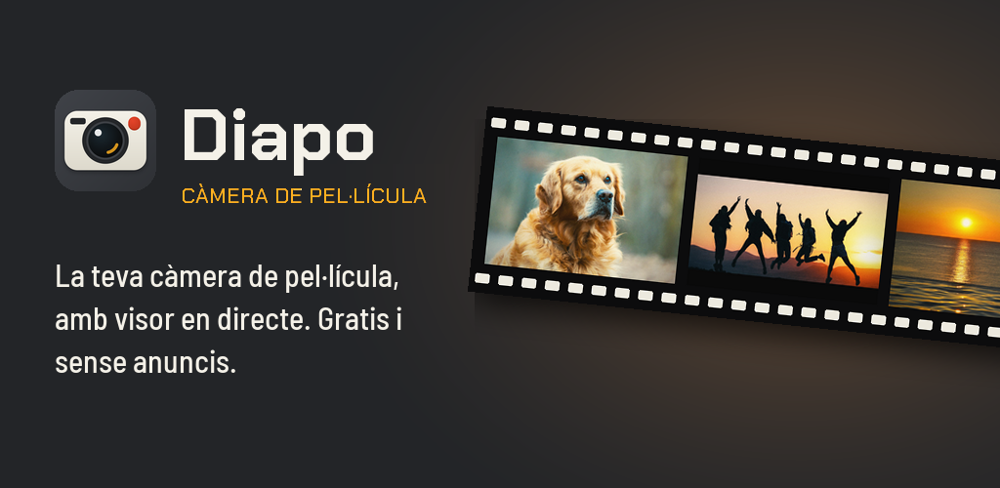
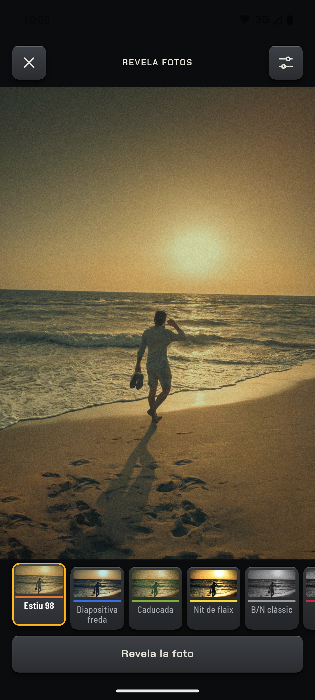
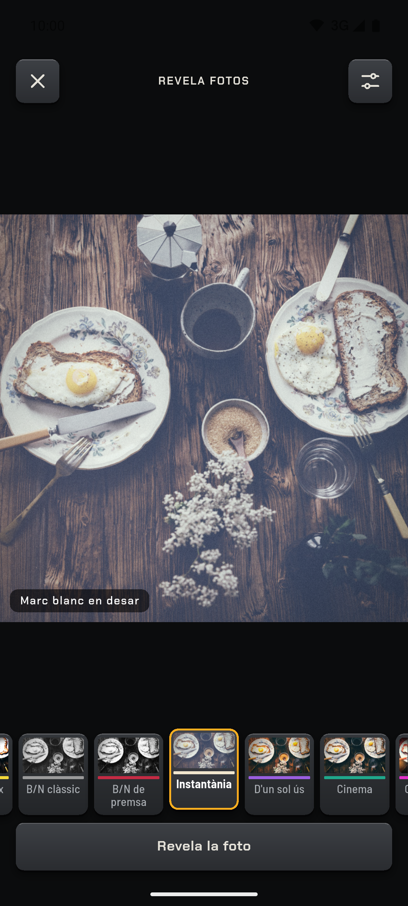
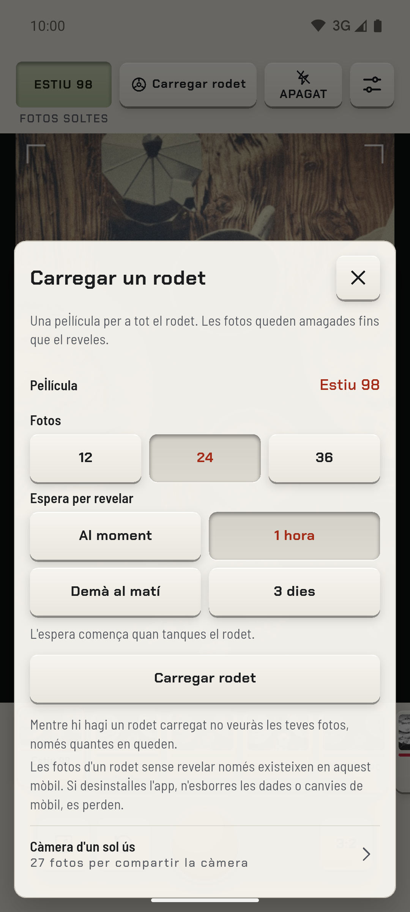
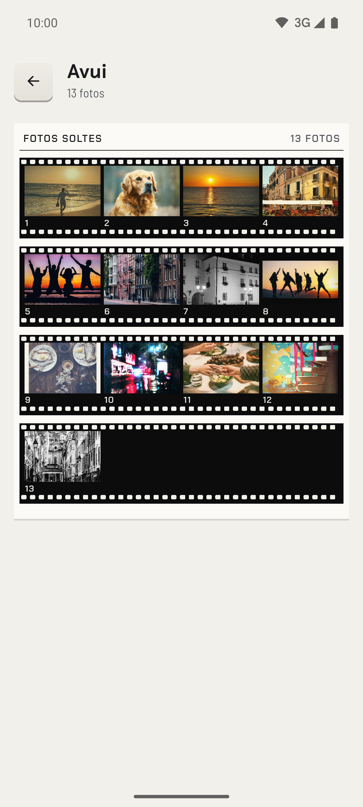
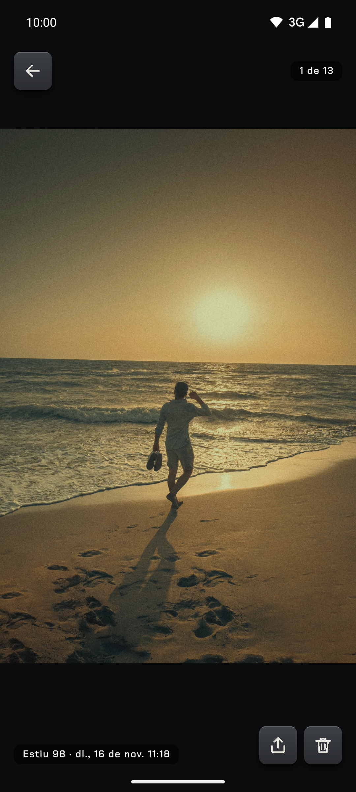
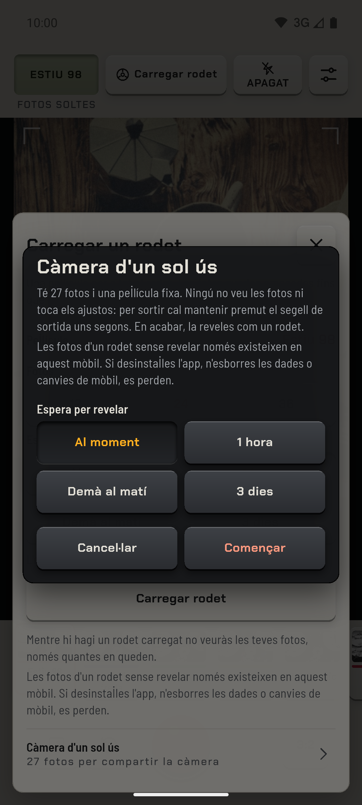
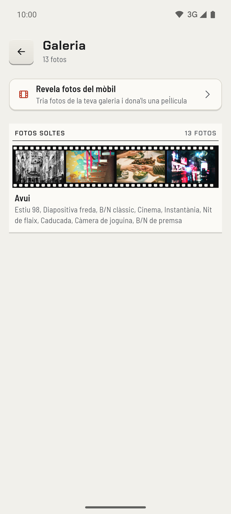

[English](README.md) · [Español](README.es.md) · **Català**

<p align="center">
  
</p>

# Diapo

[](LICENSE)
[](https://github.com/dferrandizmont/diapo/releases)
[](https://github.com/dferrandizmont/diapo/releases)
[](https://ko-fi.com/danielmfdev)

Diapo és una càmera de pel·lícula per al mòbil. Tries la pel·lícula abans de disparar, la veus en directe al visor mentre enquadres i fas la foto. És una càmera, no una app de filtres per retocar després. També pots carregar un rodet i esperar que es reveli.

**Gratis · Sense anuncis · Sense compte · Sense connexió · Codi obert**

## Baixades

<p>
  <a href="https://play.google.com/apps/testing/es.diapo.app"></a>
  <a href="https://github.com/dferrandizmont/diapo/releases/latest"></a>
  
</p>

Per ara només Android: en prova tancada a Google Play i com a APK a GitHub. L'App Store arribarà aviat. Diapo està disponible en castellà, català i anglès.

<details>
<summary>Uneix-te a la beta de Google Play</summary>

Diapo és en prova tancada a Google Play i s'hi pot apuntar qualsevol persona:

1. Uneix-te al grup de testers: [diapo-testers](https://groups.google.com/g/diapo-testers). Amb el teu compte de Google, prem «Uneix-te al grup».
2. Accepta la prova des del mòbil o l'ordinador: [play.google.com/apps/testing/es.diapo.app](https://play.google.com/apps/testing/es.diapo.app).
3. Instal·la Diapo des de Google Play. S'actualitzarà sola.

Si pots, queda't a la prova almenys 14 dies i fes alguna foto de tant en tant: Google exigeix 12 testers durant 14 dies per publicar-la per a tothom. Els comentaris, a diapo@mainshai.com.

</details>

<details>
<summary>Instal·la l’APK des de GitHub</summary>

També pots baixar l'APK de l'[última versió](https://github.com/dferrandizmont/diapo/releases/latest) i instal·lar-lo a mà (cal permetre «instal·lar aplicacions d'origen desconegut» quan Android ho demani). El seu SHA-256 es publica al costat. Està signat amb la mateixa clau que la versió de Google Play, així que l'una actualitza l'altra sense desinstal·lar i sense perdre les teves fotos; Android només no deixa tornar a una versió més antiga.

</details>

## Captures

<p>
  <a href="docs/readme/ca/01-viewfinder.png"></a>
  <a href="docs/readme/ca/02-films.png"></a>
  <a href="docs/readme/ca/03-roll.png"></a>
  <a href="docs/readme/ca/04-disposable.png"></a>
  <a href="docs/readme/ca/05-gallery.png"></a>
</p>

<details>
<summary>Més captures</summary>

<p>
  <a href="docs/readme/ca/06-viewer.png"></a>
  <a href="docs/readme/ca/07-disposable-start.png"></a>
  <a href="docs/readme/ca/08-gallery.png"></a>
</p>

</details>

Prem una captura per ampliar-la.

## Funcions

- **Visor en directe.** Llisca els cartutxos i mira color, gra, vinyetatge, fugues de llum i halo mentre enquadres.
- **La foto es veu igual.** La foto desada coincideix amb el visor, a la resolució de la teva càmera.
- **Deu pel·lícules, totes gratis.** Cap pel·lícula, format ni funció està darrere d'un pagament, i no hi ha marca d'aigua.
- **Rodets que es revelen.** Dispara sense veure les fotos i revela de seguida, després d'una espera o l'endemà al matí.
- **Càmera d'un sol ús.** 27 fotos, una pel·lícula i sense ajustos, per passar-la de mà en mà en un sopar o en un viatge.
- **Revela el que ja tens.** Tria fotos de la galeria i dona'ls una pel·lícula a màxima resolució.

<details>
<summary>Més funcions</summary>

- **Fulls de contactes.** Obre un rodet revelat com a full de contactes, posa-li nom i comparteix-lo com una imatge.
- **Ajust fi.** Quantitat de gra i vinyetatge per pel·lícula; flaix automàtic, activat, apagat o de festa.
- **Formats.** 3:2, 4:3, 1:1 i 16:9, amb data impresa opcional.
- **Detalls.** Sons d'obturador, vibracions suaus que pots apagar i un nivell al visor.
- **La teva pròpia galeria.** Rodets revelats i dies de fotos soltes, com tires de pel·lícula.

</details>

## Privacitat

Les teves fotos no surten del mòbil. Diapo no té comptes, analítiques, rastrejadors ni permís d'internet. Les fotos d'un rodet sense revelar es desen xifrades i no arriben a la galeria del sistema fins que les revelis. La ubicació és opcional i ve apagada.

<details>
<summary>Comprova-ho tu mateix</summary>

No cal refiar-se'n. El manifest de la versió final, `android/app/src/main/AndroidManifest.xml`, treu el permís `INTERNET` amb `tools:node="remove"`. Per comprovar una compilació, agafa l'APK signat de [GitHub Releases](https://github.com/dferrandizmont/diapo/releases) (cadascun porta el seu SHA-256) i llista'n els permisos:

```sh
aapt2 dump permissions diapo.apk
apkanalyzer manifest permissions diapo.apk
```

Veuràs `CAMERA`, `ACCESS_FINE_LOCATION`, `ACCESS_COARSE_LOCATION`, `POST_NOTIFICATIONS`, `RECEIVE_BOOT_COMPLETED` i accés a l'emmagatzematge fins a Android 9 (SDK 28), i cap `INTERNET`.

</details>

[Política de privacitat](https://diapo.mainshai.com/privacy/) · [Web](https://diapo.mainshai.com/) · Suport: **diapo@mainshai.com**.

## Novetats

Mira [CHANGELOG.md](CHANGELOG.md) o les [versions](https://github.com/dferrandizmont/diapo/releases).

## Contribuir

S'agraeixen incidències amb errors, idees i correccions de traducció. Per ara no s'accepten pull requests. Detalls: [CONTRIBUTING.md](CONTRIBUTING.md). Per a problemes de seguretat, mira [SECURITY.md](SECURITY.md).

## Llicència

El codi, el shader i les receptes de les pel·lícules estan sota [GPL-3.0-only](LICENSE) amb un permís addicional per enllaçar les biblioteques Google Play Core i de serveis de Play ([NOTICE.md](NOTICE.md)). El nom «Diapo», la icona i les captures no estan sota la GPL: són marques i tenen tots els drets reservats, així que un fork ha d'usar un altre nom i una altra icona. Les fonts incloses mantenen la seva pròpia llicència (SIL Open Font License 1.1).
