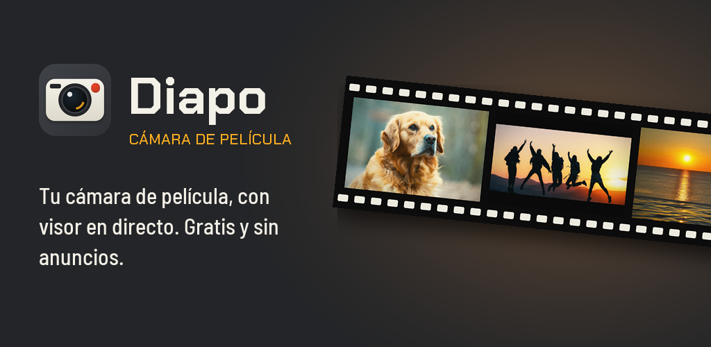
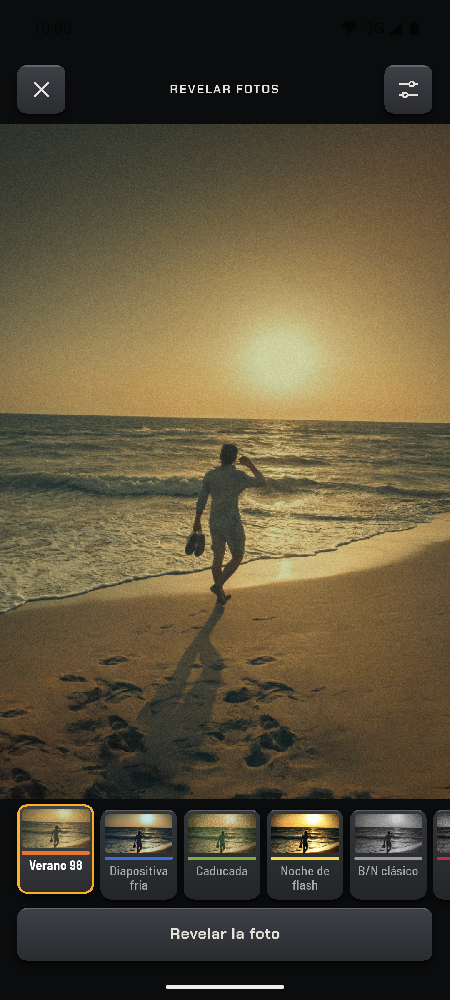
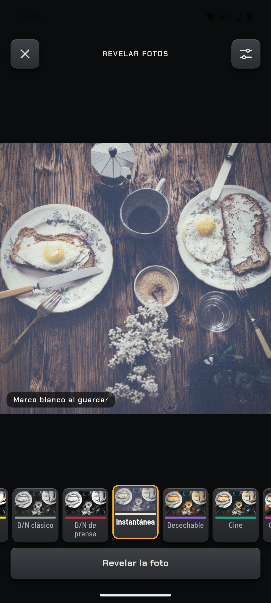
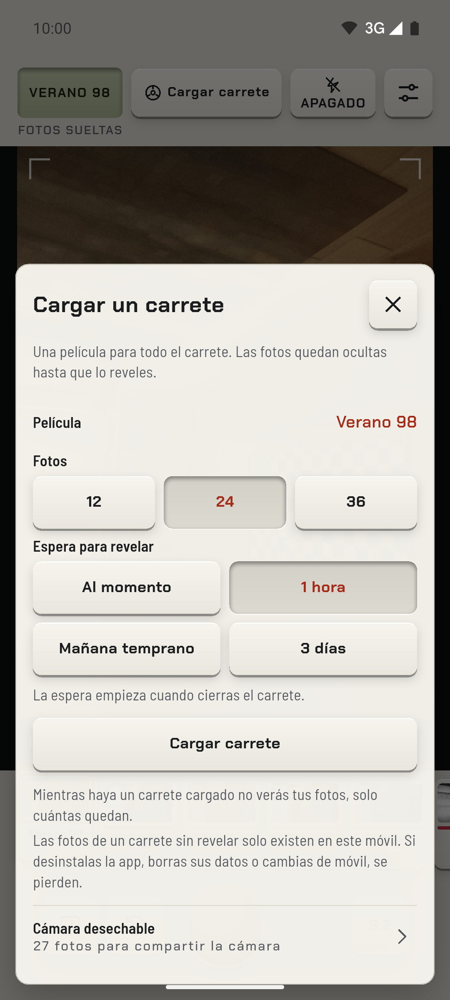
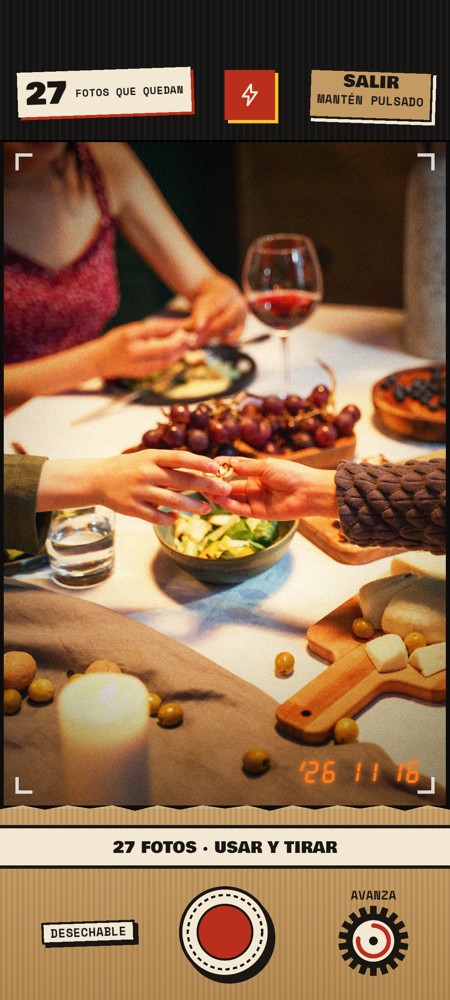
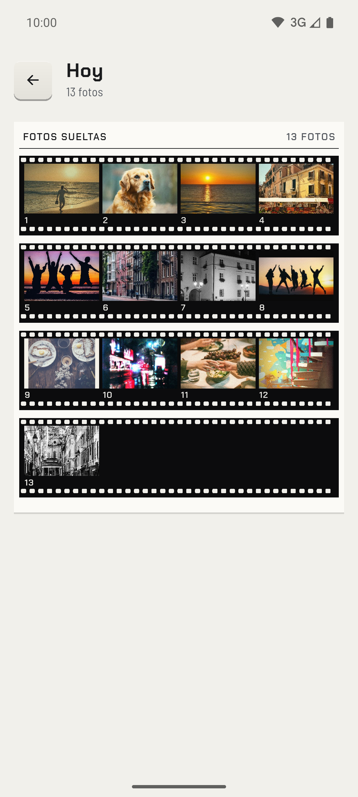
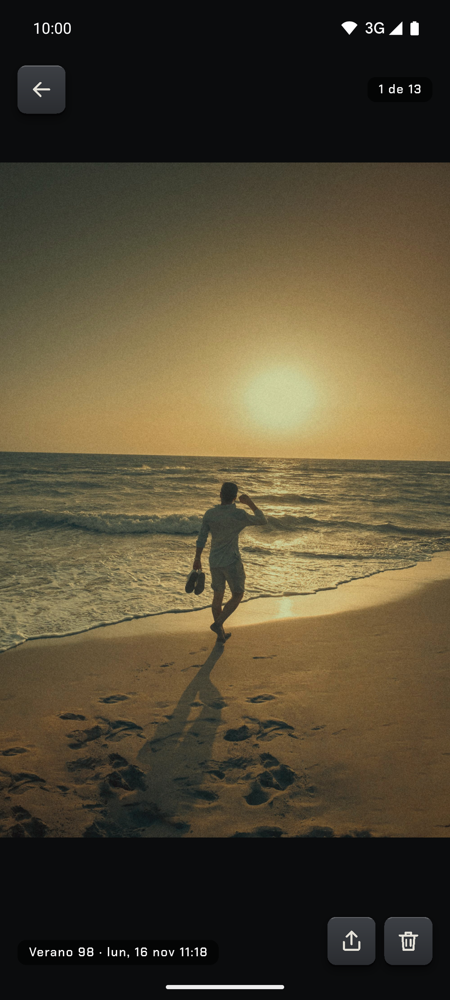
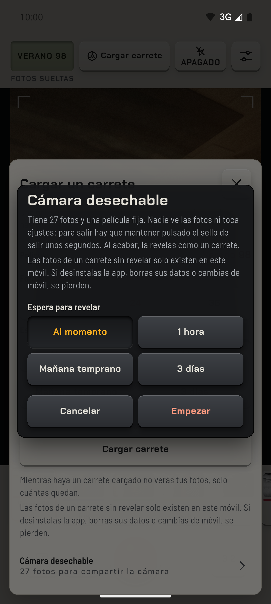
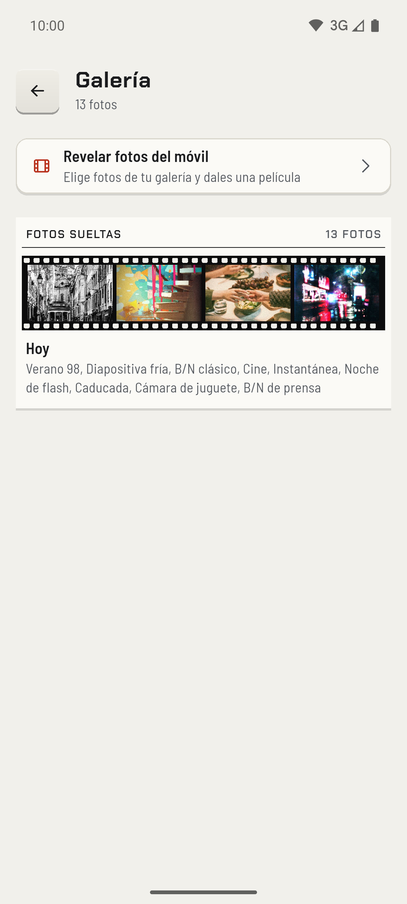

[English](README.md) · **Español** · [Català](README.ca.md)

<p align="center">
  
</p>

# Diapo

[](LICENSE)
[](https://github.com/dferrandizmont/diapo/releases)
[](https://github.com/dferrandizmont/diapo/releases)
[](https://ko-fi.com/danielmfdev)

Diapo es una cámara de película para tu móvil. Eliges la película antes de disparar, la ves en directo en el visor mientras encuadras y haces la foto. Es una cámara, no una app de filtros para retocar después. También puedes cargar un carrete y esperar a que se revele.

**Gratis · Sin anuncios · Sin cuenta · Funciona sin conexión · Código abierto**

## Descargas

<p>
  
  <a href="https://github.com/dferrandizmont/diapo/releases/latest"></a>
</p>

Por ahora solo Android. Google Play está en pruebas internas y después vendrá una prueba cerrada; la App Store llegará más adelante. Diapo está disponible en español, catalán e inglés.

<details>
<summary>Instala el APK desde GitHub</summary>

1. Descarga el APK de la [última versión](https://github.com/dferrandizmont/diapo/releases/latest). Su SHA-256 se publica junto a él.
2. Abre el archivo en el móvil y permite la instalación cuando Android lo pida.
3. Abre Diapo y permite la cámara.

</details>

## Capturas

<p>
  <a href="docs/readme/es/01-viewfinder.png"></a>
  <a href="docs/readme/es/02-films.png"></a>
  <a href="docs/readme/es/03-roll.png"></a>
  <a href="docs/readme/es/04-disposable.png"></a>
  <a href="docs/readme/es/05-gallery.png"></a>
</p>

<details>
<summary>Más capturas</summary>

<p>
  <a href="docs/readme/es/06-viewer.png"></a>
  <a href="docs/readme/es/07-disposable-start.png"></a>
  <a href="docs/readme/es/08-gallery.png"></a>
</p>

</details>

Pulsa una captura para ampliarla.

## Funciones

- **Visor en directo.** Desliza los cartuchos y mira color, grano, viñeteado, fugas de luz y halo mientras encuadras.
- **La foto se ve igual.** La foto guardada coincide con el visor, a la resolución de tu cámara.
- **Diez películas, todas gratis.** Ninguna película, formato ni función está detrás de un pago, y no hay marca de agua.
- **Carretes que se revelan.** Dispara sin ver las fotos y revela enseguida, tras una espera o a la mañana siguiente.
- **Cámara desechable.** 27 fotos, una película y sin ajustes, para pasarla de mano en mano en una cena o un viaje.
- **Revela lo que ya tienes.** Elige fotos de tu galería y dales una película a máxima resolución.

<details>
<summary>Más funciones</summary>

- **Hojas de contactos.** Abre un carrete revelado como hoja de contactos, ponle nombre y compártela como una imagen.
- **Ajuste fino.** Cantidad de grano y viñeteado por película; flash automático, activado, apagado o de fiesta.
- **Formatos.** 3:2, 4:3, 1:1 y 16:9, con fecha impresa opcional.
- **Detalles.** Sonidos de obturador, vibraciones suaves que puedes apagar y un nivel en el visor.
- **Tu propia galería.** Carretes revelados y días de fotos sueltas, como tiras de película.

</details>

## Privacidad

Tus fotos no salen del móvil. Diapo no tiene cuentas, analíticas, rastreadores ni permiso de internet. Las fotos de un carrete sin revelar se guardan cifradas y no llegan a la galería del sistema hasta que las reveles. La ubicación es opcional y viene apagada.

<details>
<summary>Compruébalo tú mismo</summary>

No hace falta fiarse. El manifiesto de la versión final, `android/app/src/main/AndroidManifest.xml`, quita el permiso `INTERNET` con `tools:node="remove"`. Para comprobar una compilación, toma el APK firmado de [GitHub Releases](https://github.com/dferrandizmont/diapo/releases) (cada uno trae su SHA-256) y lista sus permisos:

```sh
aapt2 dump permissions diapo.apk
apkanalyzer manifest permissions diapo.apk
```

Verás `CAMERA`, `ACCESS_FINE_LOCATION`, `ACCESS_COARSE_LOCATION`, `POST_NOTIFICATIONS`, `RECEIVE_BOOT_COMPLETED` y acceso al almacenamiento hasta Android 9 (SDK 28), y ningún `INTERNET`.

</details>

[Política de privacidad](https://diapo.mainshai.com/privacy/) · [Web](https://diapo.mainshai.com/) · Soporte: **diapo@mainshai.com**.

## Novedades

Mira [CHANGELOG.md](CHANGELOG.md) o las [versiones](https://github.com/dferrandizmont/diapo/releases).

## Contribuir

Se agradecen incidencias con fallos, ideas y correcciones de traducción. Por ahora no se aceptan pull requests. Detalles: [CONTRIBUTING.md](CONTRIBUTING.md). Para problemas de seguridad, mira [SECURITY.md](SECURITY.md).

## Licencia

El código, el shader y las recetas de las películas están bajo [GPL-3.0-only](LICENSE) con un permiso adicional para enlazar las bibliotecas Google Play Core y de servicios de Play ([NOTICE.md](NOTICE.md)). El nombre «Diapo», el icono y las capturas no están bajo la GPL: son marcas y tienen todos los derechos reservados, así que un fork debe usar otro nombre y otro icono. Las fuentes incluidas mantienen su propia licencia (SIL Open Font License 1.1).
