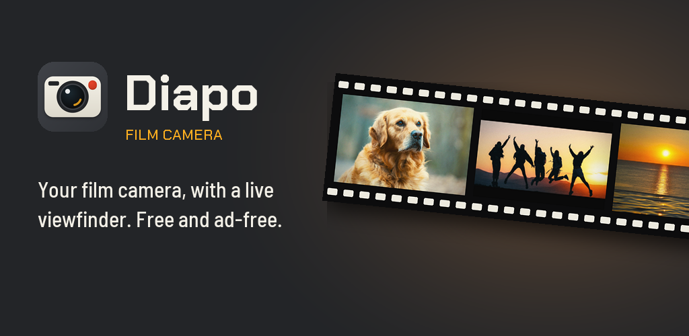
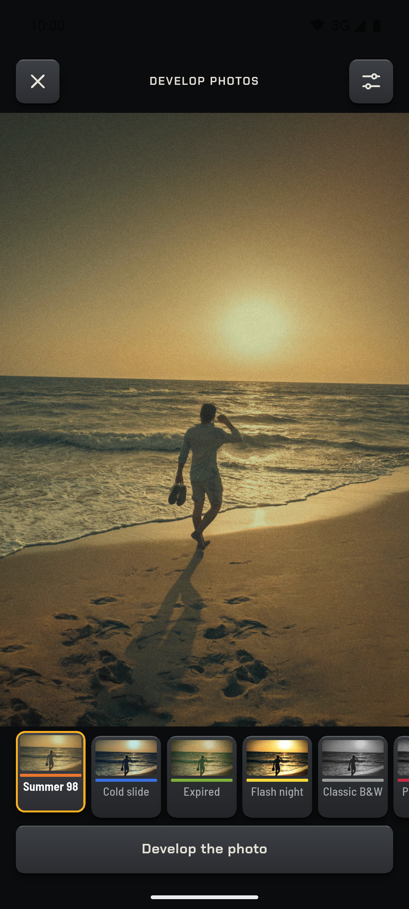
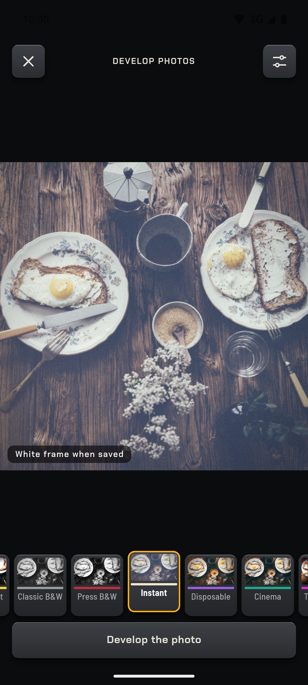
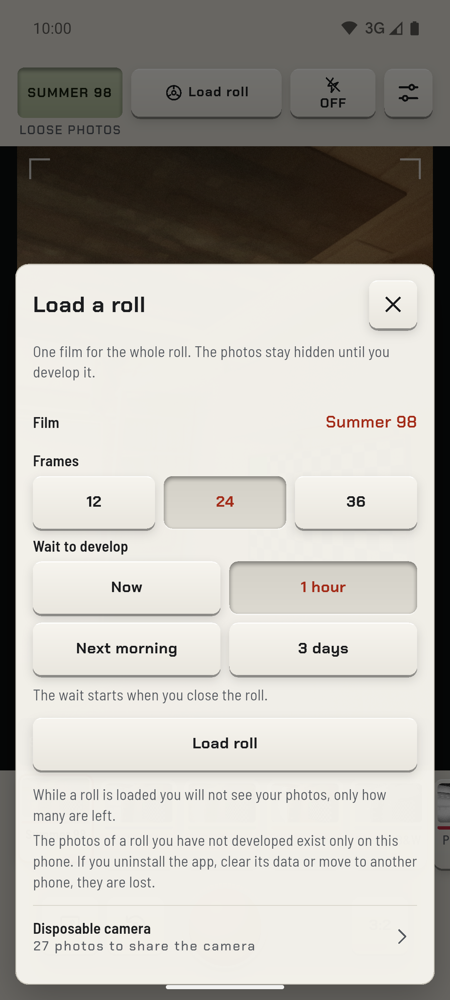
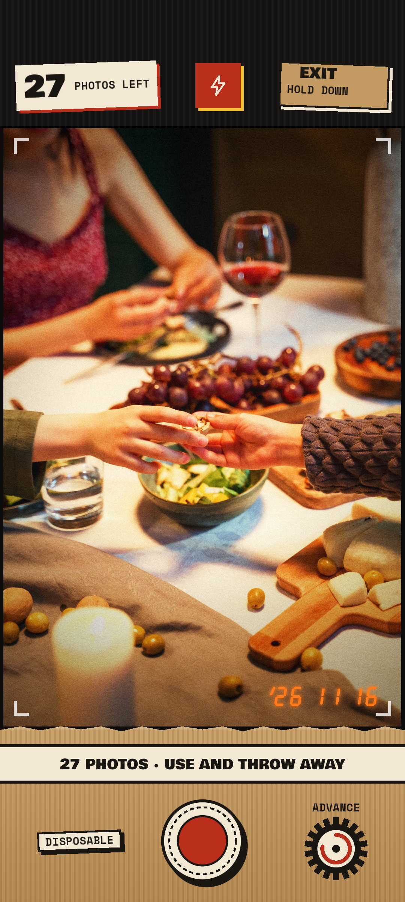
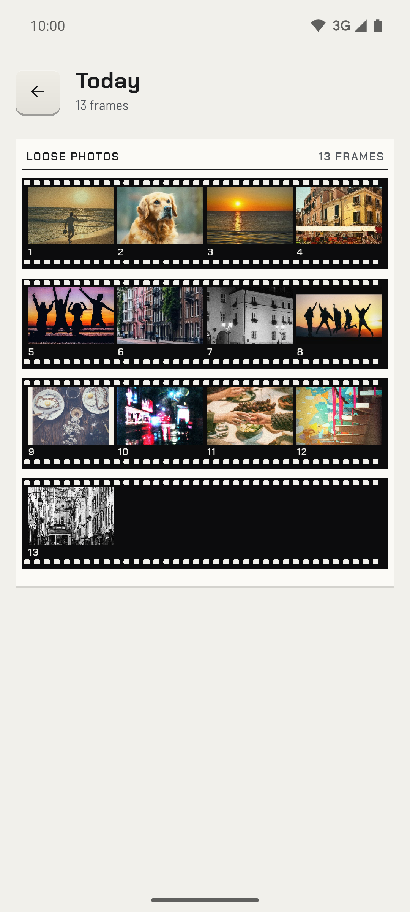
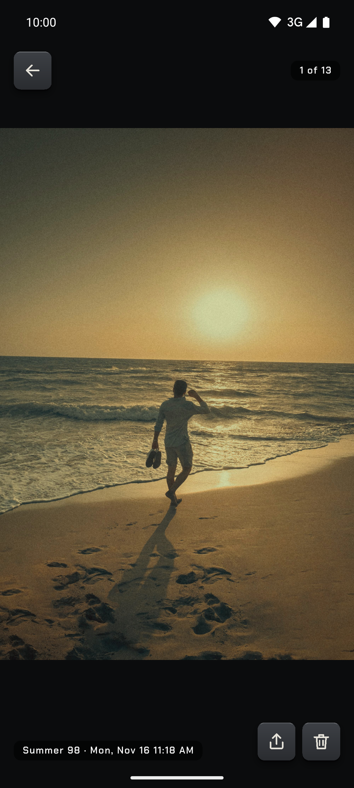
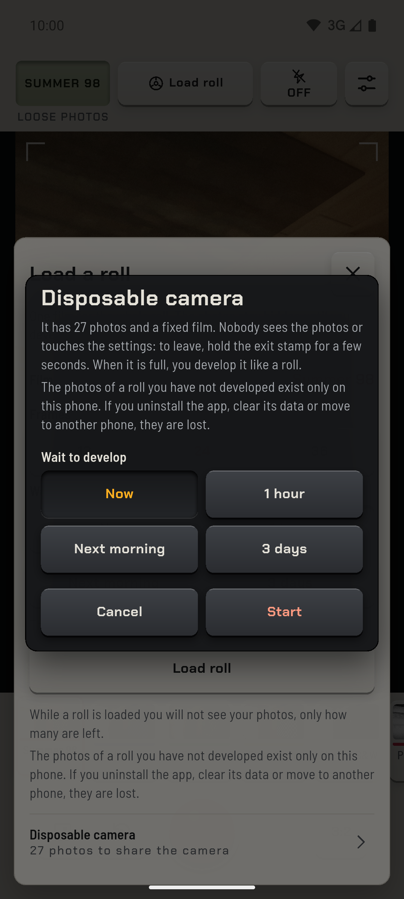
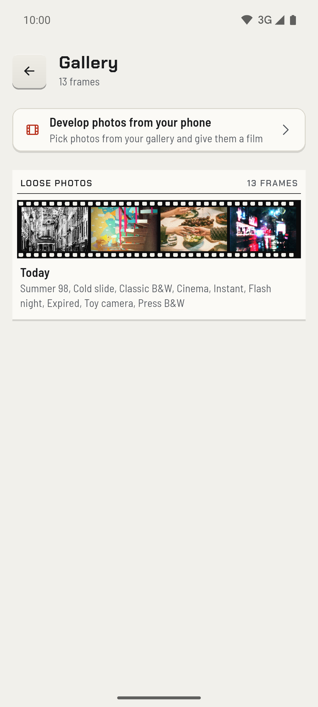

**English** · [Español](README.es.md) · [Català](README.ca.md)

<p align="center">
  
</p>

# Diapo

[](LICENSE)
[](https://github.com/dferrandizmont/diapo/releases)
[](https://github.com/dferrandizmont/diapo/releases)
[](https://ko-fi.com/danielmfdev)

Diapo is a film camera for your phone. You pick a film before you shoot, see it live in the viewfinder while you frame, and take the photo. It is a camera, not a filter app for editing afterwards. You can also load a roll and wait for it to develop.

**Free · No ads · No account · Works offline · Open source**

## Download

<p>
  
  <a href="https://github.com/dferrandizmont/diapo/releases/latest"></a>
</p>

Android only for now. Google Play is in internal testing, with a closed test to follow; the App Store is coming soon. Diapo is available in Spanish, Catalan and English.

<details>
<summary>Install the APK from GitHub</summary>

1. Download the APK of the [latest release](https://github.com/dferrandizmont/diapo/releases/latest). Its SHA-256 is published next to it.
2. Open the file on your phone and allow the installation when Android asks.
3. Open Diapo and allow the camera.

</details>

## Screenshots

<p>
  <a href="docs/readme/en/01-viewfinder.png"></a>
  <a href="docs/readme/en/02-films.png"></a>
  <a href="docs/readme/en/03-roll.png"></a>
  <a href="docs/readme/en/04-disposable.png"></a>
  <a href="docs/readme/en/05-gallery.png"></a>
</p>

<details>
<summary>More screenshots</summary>

<p>
  <a href="docs/readme/en/06-viewer.png"></a>
  <a href="docs/readme/en/07-disposable-start.png"></a>
  <a href="docs/readme/en/08-gallery.png"></a>
</p>

</details>

Tap a screenshot to enlarge it.

## Features

- **Live viewfinder.** Swipe the cartridges and see colour, grain, vignette, light leaks and halation as you frame.
- **Same look when saved.** The saved photo matches the viewfinder, at the resolution of your camera.
- **Ten films, all free.** No film, format or feature is behind a payment, and there is no watermark.
- **Rolls that develop.** Shoot without seeing the photos, then develop right away, after a wait or the next morning.
- **Disposable camera.** 27 frames, one film and no settings, to pass around at a dinner or on a trip.
- **Develop what you already have.** Pick photos from your gallery and give them a film at full resolution.

<details>
<summary>More features</summary>

- **Contact sheets.** Open a developed roll as a contact sheet, name it and share it as one image.
- **Fine-tuning.** Adjust grain and vignette per film; flash in auto, on, off or party mode.
- **Formats.** 3:2, 4:3, 1:1 and 16:9, with an optional date imprint.
- **Details.** Shutter sounds, light vibrations you can turn off, and a level in the viewfinder.
- **Your own gallery.** Developed rolls and days of loose photos, shown as film strips.

</details>

## Privacy

Your photos never leave your phone. Diapo has no accounts, no analytics, no trackers and no internet permission. Photos of an undeveloped roll are stored encrypted and do not reach the system gallery until you develop them. Location is optional and off by default.

<details>
<summary>Verify it yourself</summary>

You do not have to take this on trust. The release manifest, `android/app/src/main/AndroidManifest.xml`, removes the `INTERNET` permission with `tools:node="remove"`. To check a build, take the signed APK from [GitHub Releases](https://github.com/dferrandizmont/diapo/releases) (each comes with its SHA-256) and list its permissions:

```sh
aapt2 dump permissions diapo.apk
apkanalyzer manifest permissions diapo.apk
```

You should see `CAMERA`, `ACCESS_FINE_LOCATION`, `ACCESS_COARSE_LOCATION`, `POST_NOTIFICATIONS`, `RECEIVE_BOOT_COMPLETED` and storage access up to Android 9 (SDK 28), and no `INTERNET`.

</details>

[Privacy policy](https://diapo.mainshai.com/privacy/) · [Website](https://diapo.mainshai.com/) · Support: **diapo@mainshai.com**.

## What's new

See [CHANGELOG.md](CHANGELOG.md) or the [releases](https://github.com/dferrandizmont/diapo/releases).

## Contributing

Bug reports, ideas and translation fixes are welcome as issues. Pull requests are not accepted yet. Details: [CONTRIBUTING.md](CONTRIBUTING.md). For security problems, see [SECURITY.md](SECURITY.md).

## License

The code, the shader and the film recipes are under [GPL-3.0-only](LICENSE) with an additional permission to link the Google Play Core and Play services libraries ([NOTICE.md](NOTICE.md)). The name "Diapo", the icon and the screenshots are not under the GPL: they are trade marks and all rights reserved, so a fork must use another name and icon. Bundled fonts keep their own licence (SIL Open Font License 1.1).
